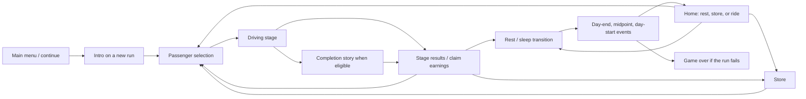

# Gulong development reference

Source audit: 5 October 2026. Baseline commit: `aff7e0e`.
Updated through 20 October 2026 for the tutorial click fix, Maingat crash tracking, centralized tuning, menu traffic, wheel animation, and crash repairs. Other findings describe the audited revision, not a promised feature roadmap.

## Editing tricycle, store and upgrades

Use **`scripts/config/game_tuning.gd`** as the shared tuning source, then restart the running game. It contains commented sections for movement, boost, crash recovery, collision clearance, perspective/headlights, weather handling, fuel/energy effects, upgrade bonuses, and store inventory/pricing.

- `PLAYER_MAX_SPEED`, `PLAYER_ACCELERATION`, and `PLAYER_BRAKE_DECELERATION` set base movement. Noon and barangay shoulder overrides are explicitly named in the same file.
- `PLAYER_BOOST_MAX_SPEED_X`, `BOOST_GAS_CONSUMPTION_PERCENT_PER_SECOND`, and `CRASH_*` control boost and crash behavior.
- `CRASH_REPAIR_*` controls trip-ending crash costs and recovery. Defaults: 25% base plus an integer random 0–25 percentage points, capped at 50% of cash and rounded down to whole pesos; one calendar day; full energy recovery.
- `ENGINE_*_BONUS_PER_LEVEL`, `BRAKE_POWER_BONUS_PER_LEVEL`, and `FUEL_EFFICIENCY_*` set upgrade effects.
- `STORE_ITEMS` holds names, descriptions, prices, per-level price increases, purchase caps, and consumable amounts. Upgrade price is `cost + current_level * cost_step`.
- `GAS_CAN_PERCENT`, `DEFAULT_GAS_PRICE`, and `DAILY_GAS_PRICE_MAX_PERCENT_CHANGE` control refill size and gas pricing. Cigarette restoration and consequences have their own constants. Food/gas descriptions and gas labels follow configured amounts.
- `MENU_TRAFFIC_VEHICLES` sets the menu's vehicle types, lanes, starting positions, speeds, and scales. `MENU_TRAFFIC_GAP_PIXELS` sets visible bumper clearance; `MENU_TRAFFIC_WRAP_*` sets offscreen entry distance. Menu perspective uses the shared lane scale settings.
- `WHEEL_ANIMATION_ENABLED`, `WHEEL_ROTATION_SPEED_X`, `WHEEL_MAX_REVOLUTIONS_PER_SECOND`, and `WHEEL_TIRE_HIGHLIGHT_STRENGTH` control wheel animation in gameplay and the menu.

Menu traffic is handled by `scripts/game/menu_traffic_controller.gd`, using the shared vehicle geometry and shadow helpers. Cars follow in lane order, resume their configured speed when clear, and wrap fully offscreen behind the existing queue. An isolated check using the actual vehicle artwork passed five simulated minutes, both directions, long frames, simultaneous exits, initial overlaps, and speed recovery; Godot editor import also passed.

`vehicle_wheel_animation.gd` and `vehicle_wheels.gdshader` animate exposed rims and rolling tire highlights using signed road speed, independent of camera movement. Each vehicle has its own material/phase; no shader wall-clock time is used, so stopped/paused vehicles freeze. Parked sprites receive no animation. Bike wheels with overlaid forks/chains use tire highlights, with no hub rotation. The pixel anchors in `VehicleWheelAnimation.LAYOUTS` must be updated when replacing vehicle artwork. Verification covered speed/stop/direction/cap behavior, material independence, menu/speeder regression checks, and a rendered comparison of all 12 moving vehicle types: changes stayed inside the wheel regions.

Trip-ending collisions now open `repair_transition.tscn`; mini crashes retain their previous behavior. `player_crash_repair_state.gd` saves the rolled bill and deduction together, plus a fixed target date and a recovery flag. Continue uses the existing sleep/story transition flow to reach the next morning, resolve debt, recover energy, and return home. Fuel and upgrades carry over, and failed trips earn no fare. Debt failure still ends the run. Reloading a pending repair neither rerolls the bill nor repeats recovery; older saves default to no pending repair. Checks covered morning/noon/night crashes, mini-crash invincibility, 300 cash/RNG cases including zero and odd balances, save/reload, reset, debt success/failure, and a rendered repair-screen-to-home transition using isolated saves.

Before repairs, the driving scene holds while crash audio finishes, then fades to black using `CRASH_REPAIR_HOLD_SECONDS` (minimum hold, default 0.35) and `CRASH_REPAIR_FADE_SECONDS` (default 1.2). Driving/retry input is blocked during the transition; the repair checkpoint is already saved. The existing entry fade is cancelled and the blackout covers dialogue as well as the HUD. Timing checks cover uninterrupted audio, a partial fade, a fully black frame, and a single scene change.

Normal stage profiles and runtime defaults now reference this file, so profile setup does not overwrite edited base values with old literals. Scene Inspector overrides for these tricycle fields have been removed. Weather, energy, upgrade, character, and special-stage modifiers still apply in their existing order. NPC traffic tuning, scene artwork/lane guides, and story-specific modifiers remain with their existing owners.

Existing saves retain current resources, capacities, and purchased levels. Starting-resource/capacity defaults apply to new runs; the configured upgrade effects apply to existing levels on the next ride. Item IDs remain compatibility keys.

Refactor verification used isolated copies with save reads/writes disabled: before/after outputs matched for 180 stage/weather combinations, upgrade levels 0–5, energy 0–13, fuel calculations, store descriptions, purchases, and purchase caps. A second copy with edited config values confirmed that changes reached gameplay setup, upgrades, fuel, store text/purchases/caps, and trip energy cost.

## Game identity and loop

Gulong is a single-player, 2D side-scrolling tricycle-driving game with a Philippine setting. John Toda earns fares while managing energy, fuel, upgrades, and a PHP 50,000 debt. Passenger encounters connect the driving loop to branching visual-novel scenes, karma, achievements, and character progression. The Windows export uses the product name **Gulong ng Buhay**.

The central decision is how much work to take on, and which trips to accept, while retaining enough money and energy to meet debt payments. Distance, traffic, time of day, weather, passenger behavior, and fatigue modify that decision. Rest trades earning opportunities for recovery; consumables trade money for continued work.



The diagram is the normal loop, not an exhaustive state machine. Day 1 has onboarding shortcuts; a saved game may resume directly into a scene. Morning and noon results advance the phase before the next passenger is selected. Night closes through sleep and the next day's setup. Story payloads can override destinations and queue later events.

## Implemented features

### Driving

- Three lanes: incoming traffic, the main lane, and the shoulder. Perspective scaling, shadows, headlights, scrolling scenery, and a speedometer support the road presentation.
- Three ride lengths, three day phases, and five traffic profiles produce 45 base profile combinations. This is a combinatorial system, not 45 separately authored levels.
- Traffic profiles: `chill`, `normal`, `traffic-jam`, `busy`, and `speeders`.
- Actual target distance is randomized: short 400–650 m, medium 700–1,050 m, long 1,150–1,650 m.
- Acceleration, braking, automatic cruising, lane changes, and fuel-consuming boost. Fatigue, upgrades, weather, and character modifiers affect handling.
- Traffic following, overtaking, variable speeds, parked vehicles, weaving, rear speeders, warning effects, lane-change prediction, and assistance against unfair NPC collisions/pinning.
- Traffic intensifies after Day 7. Visual conditions include clear/cloudy weather, rain/heavy rain, noon glow, and night visibility effects.
- Crashes normally cost one energy and briefly stop the player, followed by recovery invulnerability. Losing the remaining energy fails the trip; this is distinct from permanent run failure.
- Parked obstacles have a slow-pass exception at 40 km/h or below.
- Running out of time starts overtime and reduces fare; it does not immediately end the trip.
- Passenger dialogue includes urgent/careful complaints. Every three recorded warnings costs PHP 10 from the payout.
- First-stage tutorial, HUD, stage results, traffic-specific music pools, rain/crash/warning audio, and music carried into results.

| Input | Current behavior |
| --- | --- |
| W / Up, S / Down | Change lane |
| D / Right | Accelerate |
| A / Left | Brake |
| Shift | Boost |
| Escape | Pause in supported scenes; quit from the main menu |
| Space / R after a successful finish | Skip the exit animation to results |
| Hold R in the main menu | Reset progress |

Controls are substantially keyboard based. Built-in `ui_*` actions cover some navigation/driving functions, but lane changes and boost are hard-coded keyboard inputs; complete controller support is not implemented.

### Progression and economy

- Morning, noon, and night phases; a home screen with rest/store/ride options and daily news.
- Starting money PHP 0, energy 10/10, gas 100%, and karma 0. A selected ride costs one energy. Distance consumes 5 percentage points of gas per 1,000 distance units before efficiency modifiers; boost costs extra.
- Gas cans restore 10%. Initial gas price is PHP 70. Weather variation and the home's daily news display begin on Day 2; the news reports gas-price changes and includes tomorrow's weather forecast.
- Rest at home restores two energy while advancing morning to noon or noon to night. Night sleep restores three. Results-screen rest has additional transition rules; reuse those rules rather than applying home-rest numbers everywhere.
- Debt collection normally occurs on Days 8, 15, 22, etc., for PHP 2,500 per collection, capped by remaining debt. The first collection also has an authored story with payment/interest choices.
- Seven store entries: Engine Tune, Brake Kit, Fuel Efficiency, Warlboro Blue cigarettes, Energy Bar, Budget Meal, and Gas Can. The three upgrades have five purchasable levels each.
- Smoking has persistent consequences: ten purchases in one day unlock the smoker achievement and reduce maximum energy; fifty lifetime purchases cause a hospital-related run failure.
- Twelve achievements, pop-up notifications, and a library. Smoker and Malasakit have mechanical effects as well as descriptive text. Achievements and gallery unlocks are run-local: resetting the run clears them.
- Fare combines completed distance, overtime reduction, remaining-time bonus, time/traffic earnings multipliers, character modifiers, and passenger penalties. `game_economy_manager.gd` is authoritative; selection estimates are separate.

### Story and presentation

- A shared story interpreter renders dictionary payloads with backgrounds, portraits, speaker focus, dialogue, choices, conditional lines/actions, fades, pauses, camera changes, music/SFX, and debt overlays.
- Malasakit is a 10% random event after a completed generic-passenger ride, once per run, behind scheduled story priority. Both languages use Day 2's station/ambience and a placeholder passenger portrait. Collect preserves the saved original payout; waive pays zero and unlocks a non-stacking +5% fare bonus for the run, also reflected in ride estimates. Chance and bonus are editable in game_tuning.gd. See scripts/story/random_ride_events_guide.md.
- Named `portraits` arrays support multiple sprites above the dialogue panel, independent `flip_h`/`flip_v`, height/position/offset controls, and per-ID set/clear actions. Placement defaults to the left. Named and legacy portraits receive a 2px black outline drawn over the art inside their transparent edges at render time. Omitted arrays preserve the cast; `[]` clears it. Portrait state saves with the pending story and replays do not persist it. See `scripts/story/story_portraits_guide.md` and the payload template. Legacy left/right frames remain supported and now fit above the text box.
- Authored English/Tagalog payloads enable `speaker_portraits`: John/John Toda and Benny/Ben automatically show their artwork while speaking; narration clears the automatic portrait. The Collector/Man Outside uses `assets/characters/placeholder.png`; Arvin and Dylan intentionally have no sprites. Explicit portrait arrays override automatic casting. Backgrounds under `specialCG` suppress all portrait overlays, including on actions and resume; the background reference now saves with portrait state.
- Event values and karma preserve decisions. Character encounters and consumed dialogue track progression across rides.
- Triggers can launch at stage completion, day end, sleep midpoint, or day start, with conditions, ordered selection, one-shot tracking, and queued events.
- Scripted rider rules can force a passenger into a chosen day/phase/slot and constrain the route. “Seeded riders” refers to scheduling, not deterministic traffic RNG.
- Ten named rider definitions and six generic passenger archetypes. Named riders include Alma, Benny, Celina, Dante, Elena, Magda, Gardo, Hana, Isidro, and Jessa. Some internal IDs differ from display names; keep saved IDs stable.
- Dedicated English/Tagalog payload pairs exist for the intro, Day 2 lost banknote, Benny's class-clown encounter, Benny's night with friends, and Day 7 debt collection. Existence of a pair does not establish translation completeness: the Tagalog Day 7 payload is a placeholder.
- Memories automatically populate from the shared story_payload_catalog.gd registry (six stories, including Malasakit), unlocking when seen. Events and localized memory replay use the same builders. Six curated gallery metadata entries supplement dynamic background/CG unlocks; portrait fields/actions and character artwork are excluded, including old saved portrait unlocks. Replay suppresses persistent story effects but uses live run conditions; it is not a historical state snapshot.
- Story/passenger language is selectable and saved independently. Most menus and tutorials remain English; this is not full UI localization.
- Global audio controls for master, music, SFX, and UI; pause menu with achievements; reusable button effects and tutorial overlays.

## Technical map

The repository contains 82 GDScript files (approximately 20,000 lines) and 12 scenes. No third-party addons, automated test suite, or CI configuration were found during this audit.

| Area | Main entry points | Responsibility |
| --- | --- | --- |
| Project/bootstrap | `project.godot`, `scripts/main_menu.gd` | Engine settings, autoloads, new run/continue, intro, debug unlocks |
| Persistent state | `scripts/player_state.gd`, `scripts/state/` | Public state facade, signals, resource/debt/day/story/character rules |
| Persistence | `scripts/save/player_state_save_codec.gd`, `game_save_resource.gd` | Explicit save fields, normalization, version migration |
| Gameplay coordinator | `scripts/game.gd`, `scenes/main.tscn` | Runtime fields, setup, input dispatch, ordered frame update |
| Shared tuning | `scripts/config/game_tuning.gd` | Tricycle parameters, resources, upgrade effects and store inventory/prices |
| Stage balance | `scripts/game/stage_profiles.gd`, `game_stage_setup.gd` | Profile composition, NPC traffic, applying weather/character/special modifiers |
| Vehicle movement | `scripts/game/player_vehicle_controller.gd`, `player_vehicle_behavior.gd` | Player steering, speed, boost, perspective |
| Traffic | `scripts/game/vehicle_spawner.gd`, `vehicle_spawn_scheduler.gd`, `vehicle_traffic_controller.gd`, `vehicle_behaviors.gd` | Spawn rules, entity dictionaries, AI, following and overtaking |
| Geometry/collisions | `scripts/game/vehicle_geometry.gd`, `vehicle_collision_controller.gd` | Lane anchors, visible hitboxes, overlap/collision rules |
| Gameplay presentation | `scripts/game/game_environment_controller.gd`, `game_renderer.gd`, `game_hud.gd`, `game_audio_manager.gd` | Road/weather, drawing, HUD, audio |
| Trip completion | `scripts/game/game_flow_controller.gd`, `game_economy_manager.gd`, `scripts/stage_results.gd` | Recovery/failure, rewards, completion stories, results flow |
| Passenger selection | `scripts/ride_selection.gd`, `scripts/seeded_rider_runtime.gd` | Rider cards, forced encounters, selecting stage metadata |
| Daily flow | `scripts/day_start_scene.gd`, `day_start_transition.gd`, `sleep_transition.gd` | Home, trip intro card, rest, event checkpoints, day rollover |
| Store | `scripts/store.gd`, `scripts/store/store_item_catalog.gd` | Purchase interface and compatibility catalog referencing GameTuning.STORE_ITEMS |
| Story catalog | `scripts/story/story_catalog.gd`, `story_catalog_data.gd` | Characters, progression templates, payload selection, modifiers |
| Story triggers | `scripts/story/story_trigger_service.gd`, `story_trigger_runtime.gd`, `story_event_handler.gd` | Trigger selection, conditions, dispatch, trigger persistence |
| Story rendering/actions | `scripts/story_scene.gd`, `scripts/story/story_action_runner.gd` | Payload interpreter and persistent action vocabulary |
| Narrative content | `scripts/story/payloads/` | Intro, events, character scenes, English/Tagalog variants |
| Gallery/memories | `scripts/story/story_memory_catalog.gd`, `story_gallery_unlocker.gd`, `scripts/gallery_library.gd` | Memory entries, unlock criteria, image gallery and replay |
| Achievements | `scripts/achievement_service.gd`, `achievements_library.gd` | Definitions, counters, conditions, effects |
| Shared UI/settings | `scripts/ui/`, `scripts/audio_settings_manager.gd`, `scripts/story_language_manager.gd` | Pause, audio, tutorials, statistics, notifications, preferences |

Paths without a directory in the table are relative to the directory of that row's first entry.

### Architectural contracts to preserve

1. **`PlayerState` owns state that crosses scenes.** Its ten `RefCounted` helpers implement domain logic while the autoload keeps fields and a public facade. Use its methods/signals rather than introducing competing copies in scene scripts.
2. **Save fields are explicit.** `user://progress_save.tres` is a version-4 `GameSaveResource`; adding a member to `PlayerState` does not automatically save it. Add load/save/default/reset behavior together, and consider migration. Audio and story language use separate config files.
3. **Saves are checkpoints, not exact driving snapshots.** Scene/resume state, story position, pending transitions, selected character, and resources are stored. Live traffic positions, player speed, distance/timer, and RNG state are not a complete serialized runtime. Verify reload semantics before changing in-trip costs or restart behavior.
4. **Autosave has batching/deferred modes.** Resource setters often save immediately, while gas drain can defer writes. Treat a reward and its consumed/paid flag as one operation when extending persistence.
5. **A stage descriptor includes hyphenated traffic names.** Example: `short-morning-traffic-jam`. Use the existing parser and normalizers; do not assume every descriptor has exactly three `split("-")` elements.
6. **Phase and last-result time have different meanings.** Completion advances current phase while the result still describes the trip just finished. Rest eligibility, story conditions, and debt checks must use the appropriate one.
7. **Gameplay helpers mutate a shared `owner`.** They rely on fields in `game.gd` and mutable dictionary entities. Preserve initialization and per-frame update order when changing AI, movement, collision, or flow.
8. **`EditorPreview` is runtime configuration.** Hidden nodes in `scenes/main.tscn` provide lane guides and reference vehicle scales through `vehicle_geometry.gd`; deleting them can change actual gameplay geometry.
9. **Modifier ordering affects balance.** Profile merge: defaults → distance → time → traffic → background. Setup then applies stage randomness/target roll, weather, upgrades/energy, character modifiers, and special-stage blueprint. Inspect the complete chain before adjusting a value.
10. **Story line indices are persisted and used for branching.** `composition`, `sections`, and `lines` are supported. Inserting/reordering entries requires checking every `next_index`, conditional skip, memory start index, and existing-save resume position in both languages.
11. **Stable content IDs are save contracts.** Character, story, event, achievement, memory, upgrade, and queued-rule IDs should be migrated when renamed. In particular, legacy `tire_grip` still maps to fuel efficiency.
12. **Register audio players with `AudioSettingsManager`.** The game adjusts registered players by category rather than relying solely on separate audio buses.
13. **Story event presence is different from event truth.** `required_events` checks that a key exists, even if its value is false/zero; use `required_event_values` for exact comparisons. Character cutscenes normally also require the Day 2 bill event unless the trigger explicitly bypasses that gate.
14. **Trigger edits must account for existing saves.** Migration inserts missing trigger IDs, but does not replace saved definitions whose IDs already exist. Changing only a default definition may affect new runs without updating ongoing runs.

## Where future features belong

| Request | Implementation route |
| --- | --- |
| Tune normal driving or traffic difficulty | Edit tricycle values in `scripts/config/game_tuning.gd`; NPC traffic remains in `stage_profiles.gd`. Inspect setup modifiers and selection estimates when adjusting route balance. |
| Add a traffic vehicle | Add texture/visual definition, spawn selection, reference scale/hitbox behavior, and any new AI rule in the relevant controller |
| Add a rider | Add catalog metadata, stable ID, portrait, dialogue and optional ride modifiers; use progression helpers/seed rules for scheduling |
| Add a story scene | Start from `scripts/story/payloads/templates/story_payload_template.gd`; register both language scripts once in `story_payload_catalog.gd`, then configure routing/trigger and event keys. Memories populate automatically from the registry. |
| Extend the currently open Day 7 scene | Read both payloads, debt actions and day-end trigger together; preserve collection idempotency and language parity |
| Add a special stage | Read `scripts/game/special_stage_blueprint_guide.md`; define an explicit profile in `scripts/config/special_stages.gd`, queue `start_special_stage` from event actions, and implement custom behavior in its owning controller |
| Add a shop item or upgrade | Extend `GameTuning.STORE_ITEMS` and its effect constants; new item behaviors also need purchase dispatch and appropriate resource/gameplay logic. Include persistence if needed. |
| Add an achievement | Extend ordered definitions, event/counter logic, persistent fields and any one-time effect; existing library/popup code consumes the catalog |
| Add persistent state | Update `PlayerState`, its owning state helper, codec load/save, defaults/reset, migration, and any signals/UI consumers |
| Add a screen | Add `.tscn` and script, verify pause behavior, store its resume path if appropriate, and update main-menu resume routing |

The special-stage registry is intentionally empty; no scenarios are playable yet. Event actions now support `start_special_stage`: after the event ends, the registered explicit stage starts without energy/fuel entry requirements or trip-start energy cost. The saved `active_event_special_stage` context preserves the definition and completion status. The explicit time in `stage_type` replaces a calendar trip slot; launch clears pending sleep/selection transitions, and completion advances the phase normally and opens the special trip's results. Earlier or already-used slots roll to the next day with normal daily/debt handling. The prior fare is settled before launch. Fatal collisions enter normal repairs. Memory replays ignore the action. See `scripts/game/special_stage_blueprint_guide.md` for the authoring format. Catalog progression templates likewise are not evidence of fully authored arcs for every character.

## Findings to address before substantial expansion

These are source-traced findings, not interactive gameplay reproductions. No gameplay code was changed during the audit.

| Priority | Finding and impact | Evidence / next verification |
| --- | --- | --- |
| Fixed 20 Oct | Day 2 Keep choices now ask “Should I?” / “Sigurado ba ako?” with Yes/No. No returns to the same decision; Yes commits Keep. Both outcome branches explicitly end, preventing Keep from falling through into Return. | Confirmation nodes are appended to preserve existing line indices. All five Keep choices and both endings passed branch/reward checks in both languages. |
| High | Tagalog Day 7 debt scene contains three `test` lines, omitting the English scene's authored choices/effects. Language selection changes available content and potentially the payment path. | `scripts/story/payloads/events/scene_03_day7_night_tagalog.gd:6–25`; compare English payload and debt-trigger routing. |
| High | Reloading a story can apply its current line's rewards again: line position is saved before actions, and resume displays that same line. Benny's maximum-energy reward is a concrete non-idempotent action. | `scripts/story_scene.gd:80–85, 201–216`; `scripts/story/payloads/characters/benny/benny_tropa_night.gd:242`; `scripts/state/player_resource_state.gd:191–197`. Verify saving/reloading on a reward line. |
| Medium | A rejected traffic spawn leaves an allocated, unattached Sprite2D and its visual children without explicit cleanup. Repeated spawn retries can accumulate orphan nodes. | `scripts/game/vehicle_spawner.gd:19, 73–92`. Measure orphan counts under crowded spawns. |
| Fixed 6 October 2026 | Maingat now resets its streak on every registered crash, including survived crashes. A ride containing a crash does not count as clean, and the crash flag persists through saves. | `AchievementService.record_stage_crash`, `record_stage_completion`, and `GameFlowController.handle_player_hit`; older saves default the new flag to false. |
| Medium | Save durability has interruption windows: claiming earnings adds money before setting `paid_out`; the codec writes directly and ignores the save result. | `scripts/player_state.gd:691–700`; `scripts/save/player_state_save_codec.gd:223`. Consider batching/idempotency, checked write results, and recoverable replacement. |

Additional watch points:

- Story resume reconstructs music more thoroughly than visuals. Starting on a line without an explicit background change can leave the background unset; replay also evaluates live event/money conditions rather than a recorded branch state.
- The optional choice-response feature inserts a new line without rebasing indices (`story_scene.gd:406`). Default continuation can point back to that inserted line. Existing authored stories do not use this feature; fix/verify it before adopting it in new content.
- `Matipid` is described as a first-collection achievement, but its `debt_goal_index == 0` guard remains true with the one-entry weekly-goal array. It can be earned in a later qualifying week.
- A generic `advance_to_next_stage` path rechecks day advancement after mutating phase. Current results/sleep flow uses other paths, so treat this as a latent API hazard, not a demonstrated normal-loop debt failure.
- The legacy retry path reapplies fewer modifiers than initial stage setup. Revisit it if retry is exposed again.
- Collision uses discrete rectangles in `_process`, and logical lane changes precede visual interpolation. Test high speed, low frame rate, and lane transitions before changing collision fairness.
- Passenger penalties count displayed warning dialogue. Editing dialogue availability/timing can unintentionally rebalance payouts.
- Engine tuning applies a speed multiplier of `1 + 0.9 × level` (5.5× at level 5, before other modifiers). Selection estimates duplicate some gameplay profiles and exclude boost fuel. These warrant a balance review, not an automatic assumption that the numbers are mistakes.
- Debt code stops requiring payments once the balance is zero, but no dedicated debt-paid victory transition was found. Define the intended ending before expanding the full campaign.

## Development and validation

Configured project: Godot 4.6, GDScript, Forward Plus, Windows D3D12, 1280×720 viewport with `canvas_items` stretch. Entry scene: `res://scenes/main_menu.tscn`. The Jolt setting is for 3D physics; the actual road gameplay uses custom 2D movement/collision code.

Autoload order is AudioSettingsManager → StoryLanguageManager → PlayerState → AchievementPopupManager → PauseMenuManager → UIAudioManager. Changes to initialization should account for that order.

The local VS Code setting currently points to Godot 4.6.2. The audit successfully ran:

```powershell
& 'C:\Users\qwzrt\Documents\godot\Godot_v4.6.2-stable_win64_console.exe' --headless --path 'C:\Users\qwzrt\gim' --editor --import --log-file 'C:\Users\qwzrt\gim\.godot\analysis-editor.log'
```

The first sandboxed run could not save global editor settings; the approved repeat completed with exit code 0 and no reported errors. A scan of 172 unique literal resource paths in scripts/scenes found no missing files. These checks establish editor/import health and literal-resource presence, not full runtime correctness, performance, visual quality, or export readiness. Gameplay, audio, and a complete debt cycle were not playtested.

Before a future change, use the existing controllers/catalogs rather than expanding the main scripts indiscriminately. For behavior changes, select relevant checks from this matrix:

| Change area | Focused validation |
| --- | --- |
| Driving/traffic | Short/long routes, busy/speeders, lane transitions, low FPS, recovery after a hit, gas exhaustion |
| Economy/day flow | Morning/noon/night results, each rest path, zero/low resources, overtime, collection on Day 8, payout claimed once |
| Story | Every branch, unmet conditions, both languages, gallery replay, save/reload on reward/action lines, trigger consumption |
| Saves | Fresh run, existing v4 save, affected older-version migrations, interrupted/resumed scenes, reset behavior |
| UI | 1280×720 and another aspect ratio, mouse/keyboard focus, tutorial overlay, pause/unpause, audio category settings |
| Special modes | All setup modifiers, ID persistence through selection/results/save, generic fallback when the ID is absent |

Use a disposable save profile for progression tests: opening gameplay can autosave, and the main-menu reset removes progress. The existing `.vscode/settings.json` and `export_presets.cfg` modifications predated this audit and were left unchanged. No commits or exports were made.
